# Spano Python SDK

**Observe. Understand. Improve.**

Spano is a lightweight Python SDK for manually tracing AI-agent workflows and exporting spans to an HTTP ingestion endpoint.

It helps developers understand how an application executes, how operations relate to each other, how long individual operations take, and where failures occur.

> **Release status: Early alpha — `0.1.0`.** Automatic LangChain/LangGraph instrumentation, the ingestion backend, and the dashboard are not included in this SDK release. Review the documented behavior and test endpoint compatibility before production use.

[PyPI](https://pypi.org/project/spano/) · [GitHub](https://github.com/Sheharyar-Sarmad/Spano) · [Issues](https://github.com/Sheharyar-Sarmad/Spano/issues)

---

## Table of contents

- [1. Overview](#1-overview)
- [2. Features and scope](#2-features-and-scope)
- [3. Architecture](#3-architecture)
- [4. Installation](#4-installation)
- [5. Quick start](#5-quick-start)
- [6. Traces and spans](#6-traces-and-spans)
- [7. Nested tracing](#7-nested-tracing)
- [8. Errors and exceptions](#8-errors-and-exceptions)
- [9. Attributes and metadata](#9-attributes-and-metadata)
- [10. Configuration](#10-configuration)
- [11. Buffering and batch export](#11-buffering-and-batch-export)
- [12. HTTP ingestion protocol](#12-http-ingestion-protocol)
- [13. Transport failures and delivery](#13-transport-failures-and-delivery)
- [14. Edge cases and test matrix](#14-edge-cases-and-test-matrix)
- [15. Security and privacy](#15-security-and-privacy)
- [16. Testing and development](#16-testing-and-development)
- [17. Troubleshooting](#17-troubleshooting)
- [18. Limitations and roadmap](#18-limitations-and-roadmap)
- [19. Contributing](#19-contributing)
- [20. License](#20-license)

---

## 1. Overview

AI applications often execute a chain of operations before returning a result. An agent might retrieve documents, call external tools, query a database, and generate a response.

When an operation fails or becomes slow, developers need to understand where the time was spent and how the operations were connected.

Spano provides a way to record these operations as **traces and spans**, then export them to a compatible HTTP endpoint.

### The problem Spano addresses

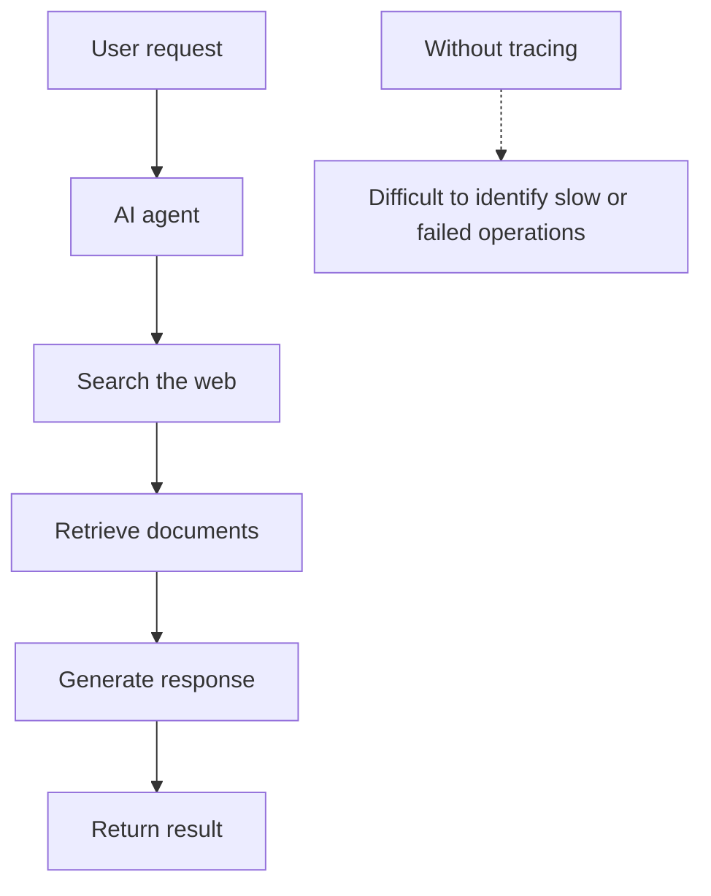

With manual instrumentation, the application can record the important stages of a workflow.

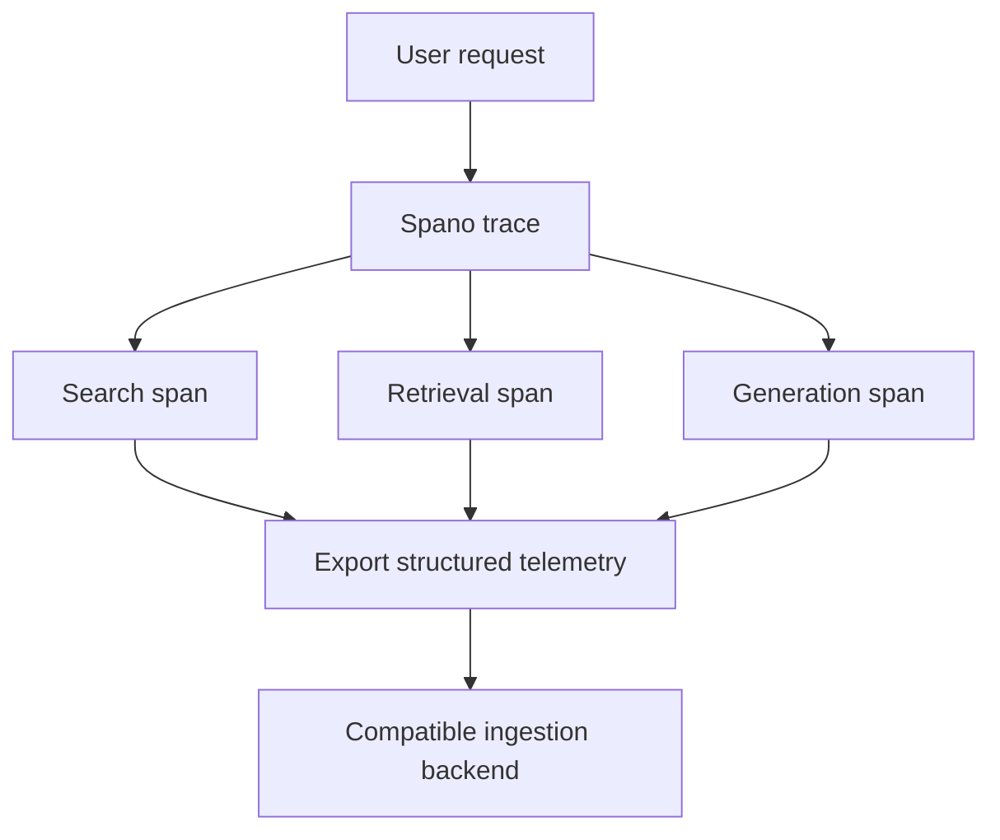

Spano records metadata explicitly provided by the developer. It does not automatically inspect prompts, completions, or application internals.

## 2. Features and scope

| Capability | Description |
|---|---|
| Manual tracing | Instrument application operations explicitly. |
| Nested spans | Represent parent-child relationships between operations. |
| Span kinds | Classify operations using supported kinds such as `SpanKind.TOOL`. |
| Timing | Record operation timestamps and duration. |
| Attributes | Attach developer-supplied metadata. |
| In-memory buffering | Collect spans before exporting them. |
| Bounded capacity | Limit buffered spans and count dropped spans. |
| Batch export | Send spans in batches. |
| HTTP transport | Send telemetry to a configured endpoint. |
| Error handling | Report transport errors through logging and an optional callback. |
| Strict transport mode | Allow transport failures to propagate from `flush()` and `close()`, according to the implementation. |

### Included versus not included

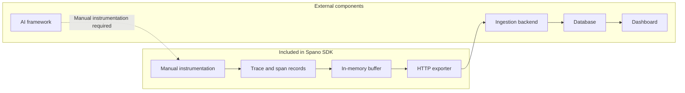

Spano does not include the backend, database, dashboard, or automatic AI-framework integrations. The diagram describes the intended integration architecture, not a bundled end-to-end service.

---

## 3. Architecture

The SDK separates application instrumentation from exporting telemetry.

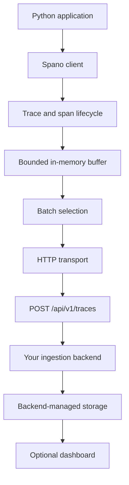

### Component responsibilities

**Python application**

Defines which operations should be traced and supplies relevant attributes.

**Spano client**

Provides the public API for creating traces, recording spans, and managing export.

**Trace and span lifecycle**

Represents operations, their timing, their status, and their relationships.

**Buffer**

Temporarily holds spans until export. Its capacity is bounded.

**HTTP transport**

Serializes and sends batches to the configured ingestion endpoint.

**Backend**

Authenticates requests, validates payloads, and decides how accepted telemetry is stored.

The SDK does not guarantee that an HTTP request accepted by a server has been durably stored. That guarantee belongs to the backend's contract.

---

## 4. Installation

### Install with pip

```bash
python -m pip install spano
```

Install a specific release:

```bash
python -m pip install "spano==0.1.0"
```

### Install with uv

Add Spano to an existing project:

```bash
uv add spano
```

Try it in a temporary environment:

```bash
uv run --with spano python -c "import spano; print(spano.__file__)"
```

### Verify installation

```bash
python -m pip show spano
python -c "import spano; print(spano.__file__)"
```

If Python cannot import the package, verify that you installed it into the same interpreter or virtual environment you are using to run your application.

---

## 5. Quick start

The following example demonstrates the intended public API. Confirm the exported names and method signatures against the installed release.

```python
from spano import Spano, SpanKind

client = Spano(
    api_key="your-api-key",
    endpoint="http://localhost:8000",
)

try:
    with client.start_trace(
        "research-agent",
        attributes={"environment": "dev"},
    ) as trace:
        with trace.start_span(
            "search-web",
            kind=SpanKind.TOOL,
            attributes={"tool": "web-search"},
        ):
            # Execute the actual tool operation here.
            pass
finally:
    client.close()
```

The endpoint must have a compatible server running. This SDK does not start a backend for you.

### Execution lifecycle

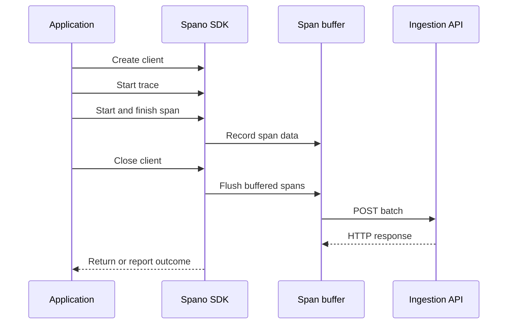

This sequence illustrates the expected flow. Exact ordering, error propagation, and buffer behavior should be verified against the implementation.

### What the example demonstrates

1. Create a client with an API key and endpoint.
2. Start a trace for the overall operation.
3. Start a child span for a tool call.
4. Execute the application operation inside the span.
5. Close the client so it attempts to flush buffered spans.

A call to `close()` is an attempt to export data, not proof that the backend persisted it.

---

## 6. Traces and spans

A **trace** represents a complete unit of work, such as handling one agent request.

A **span** represents one operation within that work, such as searching the web or querying a database.

### Trace hierarchy

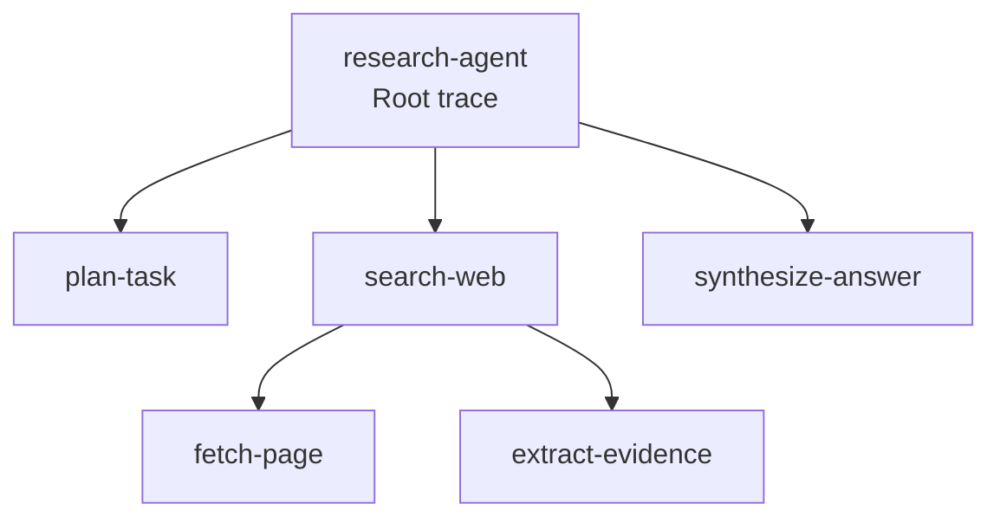

A trace groups related operations. Child spans provide more detail about the work performed within the overall trace.

### Span lifecycle

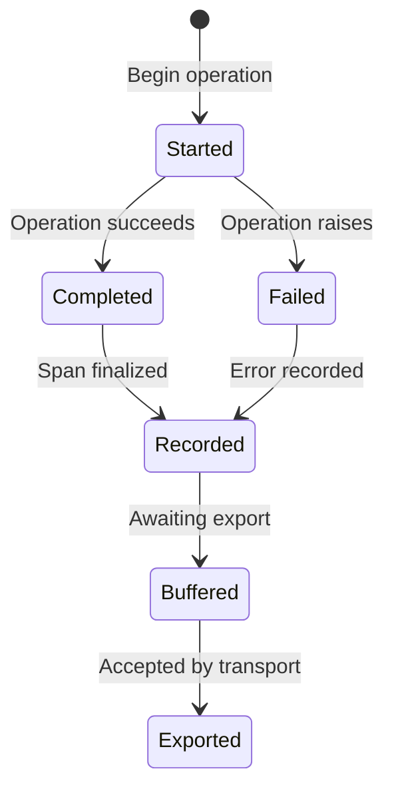

This is a conceptual lifecycle diagram. It does not imply that the SDK implements every state as a separate object or exposes these states as public API values.

### Typical span fields

The documented ingestion payload includes fields such as:

| Field | Meaning |
|---|---|
| `trace_id` | Identifier shared by spans in a trace. |
| `span_id` | Identifier for one span. |
| `parent_span_id` | Parent span identifier, or `null` for a root span. |
| `name` | Operation name. |
| `kind` | Operation category. |
| `start_time` | Start timestamp. |
| `end_time` | End timestamp. |
| `duration_ms` | Duration in milliseconds. |
| `status` | Operation outcome. |
| `attributes` | Developer-supplied metadata. |
| `error` | Error information when applicable. |

The actual identifier format, timestamp format, status values, and error serialization are defined by the SDK implementation and its ingestion contract.

---

## 7. Nested tracing

Nested spans help identify which stage of a workflow consumed time or failed.

```python
from spano import Spano, SpanKind

client = Spano(
    api_key="your-api-key",
    endpoint="http://localhost:8000",
)

try:
    with client.start_trace("document-research") as trace:
        with trace.start_span(
            "retrieve-documents",
            kind=SpanKind.TOOL,
        ):
            # Retrieve documents.
            pass

        with trace.start_span(
            "rank-documents",
            kind=SpanKind.TOOL,
        ):
            # Rank the retrieved documents.
            pass

        with trace.start_span("generate-summary"):
            # Generate the summary.
            pass
finally:
    client.close()
```

### Parent-child relationships

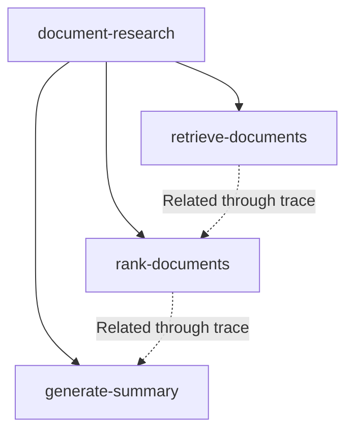

The dotted lines are illustrative workflow order, not additional parent-child relationships. In the hierarchy, the three operations are children of the root.

### Choosing span names

Prefer stable, descriptive names:

- `retrieve-documents`
- `query-vector-store`
- `search-web`
- `generate-summary`
- `validate-output`

Avoid including credentials, complete prompts, user-specific data, or secret-bearing URLs in span names.

Use enough spans to answer meaningful debugging questions without generating unnecessary telemetry.

---

## 8. Errors and exceptions

Spano's documented behavior is to record application exceptions in spans and re-raise them. The SDK should not silently convert an application failure into success.

```python
from spano import Spano

client = Spano(
    api_key="your-api-key",
    endpoint="http://localhost:8000",
)

try:
    with client.start_trace("document-processing") as trace:
        with trace.start_span("validate-document"):
            raise ValueError("Invalid document format")
finally:
    client.close()
```

The caller should continue to handle application errors normally.

### Error flow

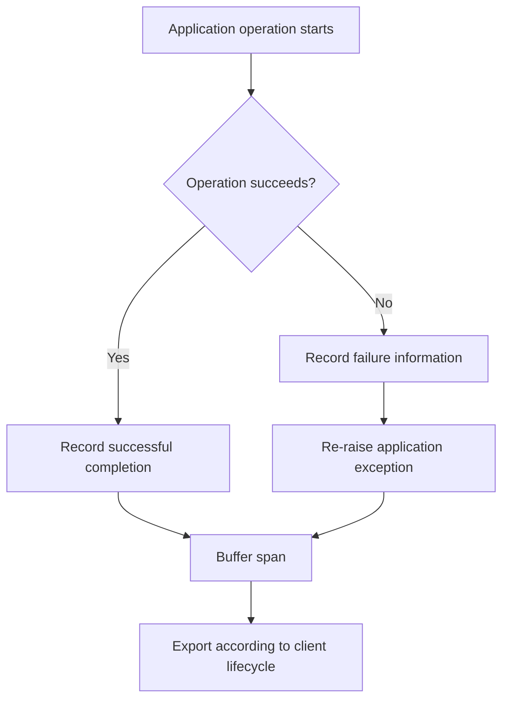

The diagram describes intended exception and recording behavior. Confirm the exact behavior when span finalization itself fails or when the exporter fails while an application exception is already being raised.

### Safe error metadata

Useful error context might include:

```json
{
  "operation": "retrieve-documents",
  "error_type": "TimeoutError",
  "retryable": true
}
```

This is an illustrative metadata object, not an automatically generated Spano schema.

Avoid storing full request bodies, secrets, or private documents in error attributes.

---

## 9. Attributes and metadata

Attributes add context to traces and spans.

For example:

```python
{
    "environment": "staging",
    "operation": "document-search",
    "provider": "example-provider",
    "model": "example-model",
    "attempt": 1
}
```

These are example values; they are not automatically generated by the SDK.

### Attribute design

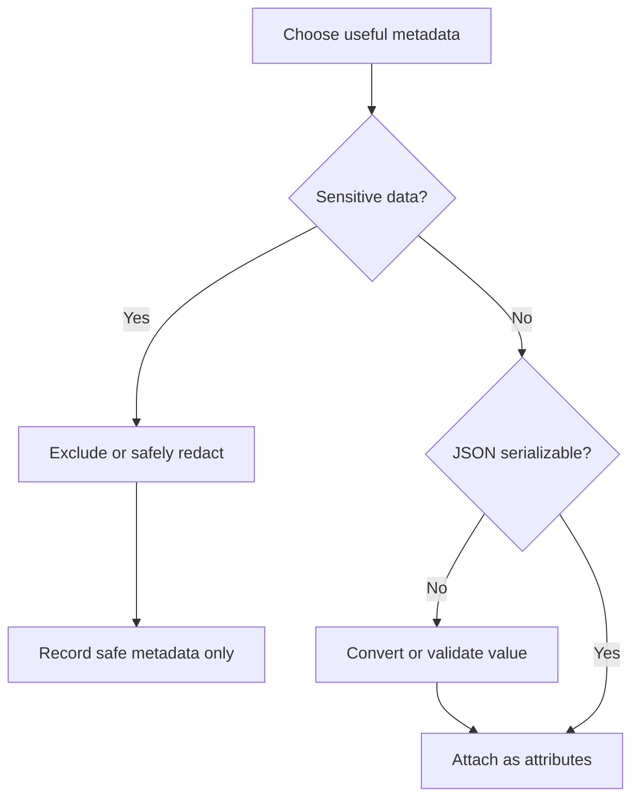

Recommended practices:

- Prefer small, structured values.
- Use consistent attribute names.
- Avoid attaching full documents or conversations.
- Never record API keys, passwords, access tokens, or session cookies.
- Check that values can be serialized by the SDK's JSON handling.
- Follow your backend's schema and retention policies.

---

## 10. Configuration

The documented constructor signature is:

```python
Spano(
    api_key,
    endpoint="http://localhost:8000",
    timeout=5.0,
    ingestion_path="/api/v1/traces",
    max_buffer_size=1000,
    batch_size=100,
    strict_transport=False,
    logger=None,
    on_error=None,
)
```

| Parameter | Purpose | Documented default |
|---|---|---|
| `api_key` | Credential for authenticated ingestion. | Required |
| `endpoint` | Base URL of the ingestion server. | `http://localhost:8000` |
| `timeout` | HTTP transport timeout setting. | `5.0` |
| `ingestion_path` | HTTP ingestion path. | `/api/v1/traces` |
| `max_buffer_size` | Maximum buffered span count. | `1000` |
| `batch_size` | Maximum spans per export batch. | `100` |
| `strict_transport` | Controls transport error propagation. | `False` |
| `logger` | Optional application logger. | `None` |
| `on_error` | Optional transport error callback. | `None` |

Check the source and tests for accepted value ranges and validation behavior. Do not assume invalid values are automatically corrected.

### Endpoint construction

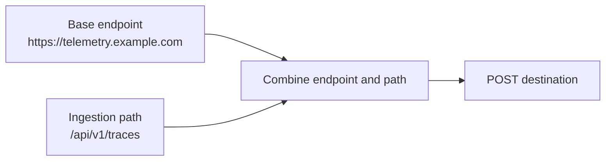

Use HTTPS for remote services. The endpoint should be a base URL, with the ingestion path configured separately.

### Timeout trade-offs

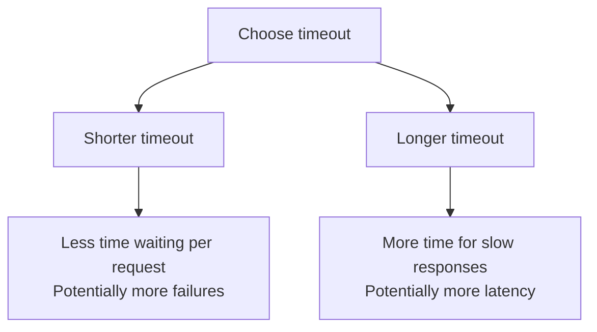

Verify whether the transport applies its timeout to connection establishment, response reading, or both.

---

## 11. Buffering and batch export

Spano temporarily buffers spans before sending them to the ingestion endpoint.

The documented default buffer capacity is `1000` spans, and the default batch size is `100`.

### Buffer and exporter architecture

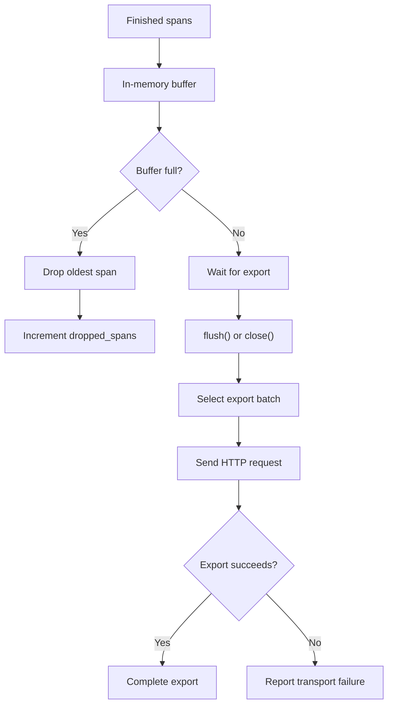

The diagram illustrates the documented bounded-buffer policy and a conceptual export flow. Verify the exact removal, retry, and buffer-retention behavior in the source.

### Buffer overflow

When the buffer reaches capacity, the oldest span is dropped and `client.dropped_spans` increments.

This means:

- An unavailable endpoint can allow the buffer to fill.
- Dropped spans represent missing telemetry.
- Spans discarded from memory cannot be recovered by a later successful export.
- Buffered data can be lost if the process exits unexpectedly.

### Batch sizing

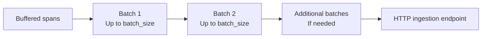

Batching reduces per-request overhead, but larger batches increase payload size and may increase the impact of failed requests.

Test how the implementation behaves when the buffer contains fewer spans than the batch size, more spans than one batch, or new spans while export is in progress.

Do not assume background flushing, retries, or durable persistence unless implemented and documented.

---

## 12. HTTP ingestion protocol

Spano sends a `POST` request to the configured endpoint and ingestion path.

### Request flow

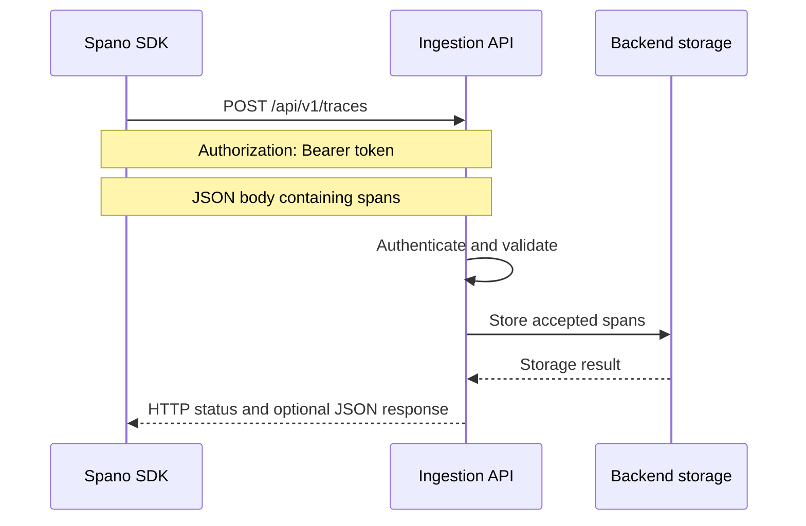

Storage is a backend responsibility. The diagram shows a possible server implementation, not a component included with Spano.

### HTTP request

```http
POST /api/v1/traces
Authorization: Bearer <api-key>
Content-Type: application/json
```

The configured base endpoint and ingestion path determine the full destination URL.

### Example request body

```json
{
  "spans": [
    {
      "trace_id": "example-trace-id",
      "span_id": "example-span-id",
      "parent_span_id": null,
      "name": "research-agent",
      "kind": "agent",
      "start_time": "2026-01-01T10:00:00Z",
      "end_time": "2026-01-01T10:00:01Z",
      "duration_ms": 1000.0,
      "status": "ok",
      "attributes": {
        "environment": "dev"
      },
      "error": null
    }
  ]
}
```

This payload is illustrative. The identifiers and timestamps are examples.

### Response requirements

The documented contract requires:

- A successful `2xx` HTTP status.
- If the response body is non-empty, it must be a JSON object.
- An optional integer `accepted` field should equal the number of spans in the request.

Example response:

```json
{
  "accepted": 1
}
```

### Response validation flow

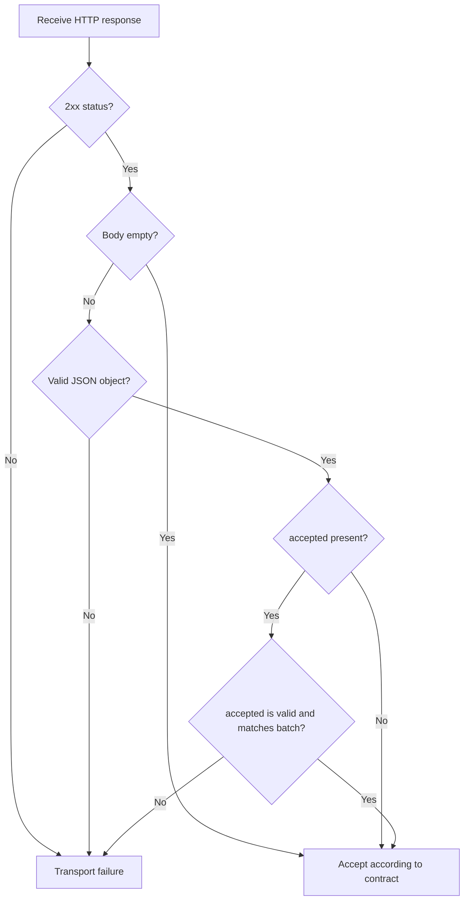

This flow reflects the documented protocol expectations. Confirm that the released implementation enforces every validation step, including how it treats booleans, non-integer values, malformed JSON, and incorrect counts.

### Backend responsibilities

A compatible ingestion service should:

1. Authenticate the bearer token.
2. Validate payload structure and field types.
3. Enforce request and batch-size limits.
4. Return appropriate HTTP statuses.
5. Define what successful acceptance means.
6. Avoid logging authorization headers.
7. Define duplicate-submission and partial-failure behavior.

Spano does not include this backend.

---

## 13. Transport failures and delivery

The documented default is best-effort transport behavior.

### `flush()`

`flush()` attempts to export buffered spans.

- Returns `True` on success.
- Returns `False` when best-effort delivery fails.
- In strict mode, transport errors are raised according to the implementation.

### `close()`

`close()` attempts to flush remaining buffered spans and is documented as safe to call more than once.

Call it during application shutdown or from a `finally` block. Confirm the precise behavior if flushing fails.

### Failure-handling flow

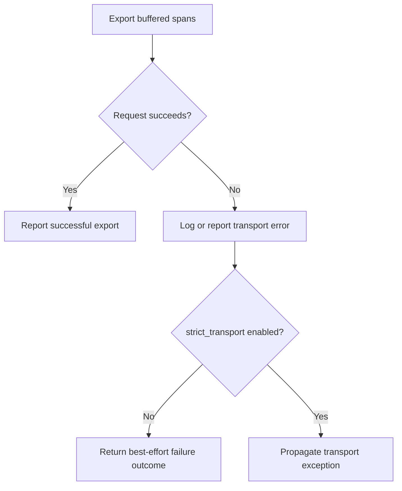

This is a conceptual decision flow. Verify exact return values, exception types, and buffer state against the SDK source.

### Optional error callback

An `on_error` callback can be supplied to observe transport failures.

Before relying on it, test:

- Its expected argument signature.
- Whether it runs once per failed request or once per error.
- Whether callback exceptions are caught.
- Whether it executes synchronously.
- Whether callback errors can replace the original transport error.

Keep callbacks lightweight and avoid recursively sending exporter failures through the same failing telemetry path.

### Delivery guarantees

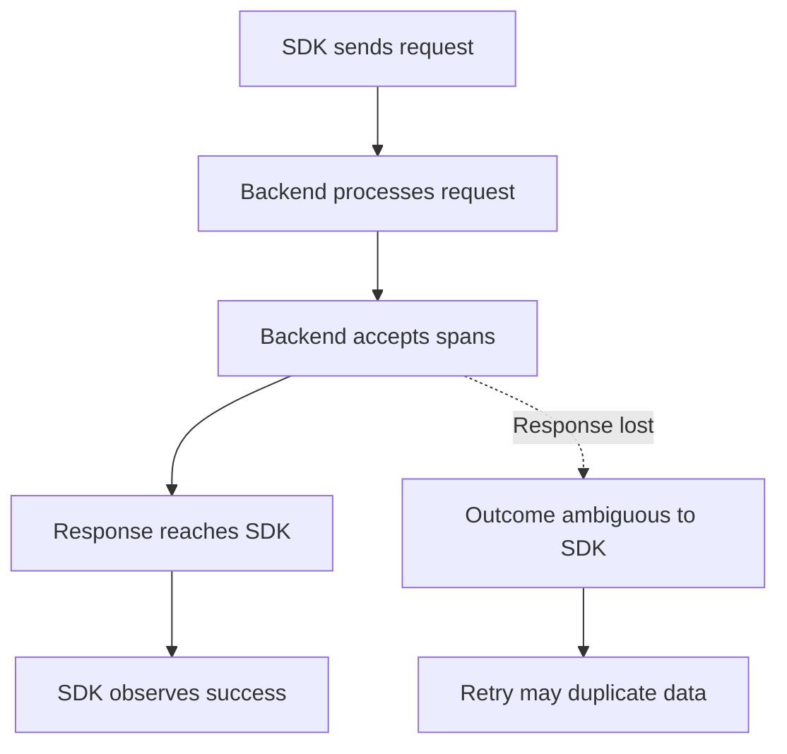

An HTTP request can be processed by the server even if its response never reaches the client. Retrying such a request can create duplicates unless the backend supports deduplication.

Spano's in-memory buffer is not a durable message queue. Do not assume at-least-once or exactly-once delivery.

---

## 14. Edge cases and test matrix

The following matrix separates documented behavior from behavior that should be verified.

| Scenario | Expected behavior or test requirement |
|---|---|
| Application exception inside a span | Exception is recorded and re-raised, according to the documented contract. |
| Buffer reaches capacity | Oldest span is dropped and `dropped_spans` increments. |
| `close()` called repeatedly | Documented as safe to call more than once. |
| Empty-buffer `flush()` | Verify return value and whether a request is sent. |
| HTTP `401` or `403` | Verify authentication failure handling. |
| HTTP `404` | Verify endpoint path configuration and error reporting. |
| HTTP `429` | Verify retry behavior; do not assume retries exist. |
| HTTP `500` | Verify failure reporting and buffer state. |
| Empty successful response body | Permitted by the documented ingestion contract. |
| Malformed non-empty response | Verify protocol error handling. |
| JSON response is an array or scalar | Verify that non-object responses are rejected. |
| Incorrect `accepted` count | Verify mismatch detection. |
| Unserializable attribute | Verify validation and serialization failure handling. |
| More spans than one batch | Verify splitting, ordering, and export behavior. |
| Export failure during `close()` | Verify error propagation and remaining buffer state. |
| Callback raises | Verify isolation and original-error handling. |
| Process exits unexpectedly | In-memory buffered data may be lost. |
| Connection drops after backend processing | Outcome can be ambiguous; duplicates are possible. |
| Concurrent span creation | Verify thread safety and context isolation. |
| Nested span raises | Verify parent-child relationships and completion status. |
| Invalid configuration | Verify validation and exception types. |
| System clock changes | Verify timestamp and duration behavior. |

### Test lifecycle

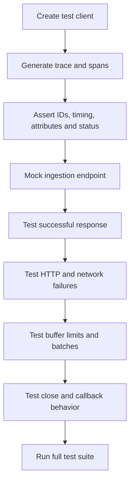

A scenario listed here is a recommendation, not a claim that it is already covered by the current release.

---

## 15. Security and privacy

Telemetry can expose sensitive application data if attributes and errors are not carefully controlled.

### Use environment-based credentials

```python
import os

from spano import Spano

client = Spano(
    api_key=os.environ["SPANO_API_KEY"],
    endpoint=os.environ["SPANO_ENDPOINT"],
)
```

Set both environment variables before running the application. Never commit real credentials to the repository.

### Safe attribute pipeline

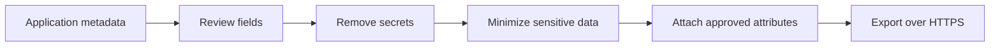

Avoid recording:

- Passwords, API keys, access tokens, and cookies.
- Full prompts or model completions unless explicitly justified and protected.
- Private documents or database records.
- Personal information without a legitimate need.
- Authorization headers or secret-bearing URLs.

### Production security checklist

- [ ] Remote ingestion uses HTTPS.
- [ ] Credentials come from a secure configuration source.
- [ ] Sensitive attributes are excluded or redacted.
- [ ] The backend authenticates and validates requests.
- [ ] Request size limits are enforced.
- [ ] Logs do not expose credentials.
- [ ] Retention and deletion policies are defined.
- [ ] Error messages do not leak sensitive data.

---

## 16. Testing and development

Run development commands from the `SDK/` directory.

### Install development dependencies

```bash
uv sync
```

### Run tests

```bash
uv run pytest
```

Alternatively, if the test dependencies are installed in the active environment:

```bash
python -m pytest
```

### Build distributions

```bash
uv build
```

Or use the Python build frontend if it is installed:

```bash
python -m build
```

### Validate package metadata

```bash
python -m twine check dist/*
```

### Development and release pipeline

```mermaid
flowchart TD
    A["Change SDK code"] --> B["Run unit tests"]
    B --> C{"Tests pass?"}
    C -- No --> D["Fix implementation or tests"]
    D --> B
    C -- Yes --> E["Build wheel and source distribution"]
    E --> F["Validate distributions"]
    F --> G["Install wheel in clean environment"]
    G --> H["Verify public API"]
    H --> I["Prepare versioned release"]
```

### Recommended test coverage

Add dedicated tests for:

- Empty-buffer flushing.
- Buffer overflow and dropped-span counts.
- Batch boundaries and multiple batches.
- HTTP success, timeouts, and connection errors.
- Malformed response bodies and incorrect `accepted` counts.
- Strict versus best-effort transport behavior.
- Callback exceptions.
- Nested spans and application exceptions.
- Repeated `close()` calls.
- Concurrency and context isolation.
- Invalid configuration values.
- Clean-wheel installation and import behavior.

Use a mocked HTTP server or transport for deterministic failure tests. Avoid depending on a live production endpoint in unit tests.

---

## 17. Troubleshooting

### `ModuleNotFoundError: No module named 'spano'`

Check the installed package and Python executable:

```bash
python -m pip show spano
python -c "import sys; print(sys.executable)"
```

Make sure the package and application use the same environment.

### `401 Unauthorized` or `403 Forbidden`

Check the API key, bearer authentication, and backend authorization rules. Do not print the secret while debugging.

### `404 Not Found`

Check the configured base URL and ingestion path. The documented default is `/api/v1/traces`.

### `flush()` returns `False`

Inspect the logger and error callback. Check endpoint reachability, HTTP status, response structure, authentication, and timeout settings.

### Traces are missing

Investigate:

- Buffer overflow and `dropped_spans`.
- Failed or skipped flushes.
- Process shutdown before export.
- Incorrect endpoint configuration.
- Backend validation or persistence failures.

### GitHub Actions succeeds but local installation fails

Verify the package version, Python interpreter, and configured package index. Try a clean virtual environment and confirm the import path.

### Troubleshooting decision tree

```mermaid
flowchart TD
    A["Trace not visible in backend"] --> B{"Span created?"}
    B -- No --> C["Check instrumentation and context"]
    B -- Yes --> D{"Buffered?"}
    D -- No --> E["Inspect lifecycle and validation"]
    D -- Yes --> F{"Export attempted?"}
    F -- No --> G["Call flush or close as appropriate"]
    F -- Yes --> H{"HTTP request successful?"}
    H -- No --> I["Inspect transport errors and response"]
    H -- Yes --> J["Inspect backend validation and persistence"]
```

This decision tree is a debugging guide, not an assertion that Spano exposes all these internal states.

---

## 18. Limitations and roadmap

### Current limitations

Spano `0.1.0` is an early alpha.

- Instrumentation is manual.
- Automatic LangChain and LangGraph instrumentation is not included.
- The SDK does not include a hosted ingestion service.
- The SDK does not provide a dashboard.
- Buffered spans are not durable local storage.
- Automatic retries and delivery guarantees must not be assumed.
- Concurrency guarantees should be verified before concurrent use.
- The public API and ingestion contract may change.

### Architecture direction

```mermaid
flowchart TD
    A["Current: manual instrumentation"] --> B["More integration options"]
    B --> C["Improved context propagation"]
    C --> D["Explicit retry and backoff policies"]
    D --> E["Exporter health metrics"]
    E --> F["Reference ingestion backend"]
    F --> G["Trace querying and visualization"]
```

This is a possible development direction, not a commitment or a description of features already shipped.

Potential improvements include better integration adapters, more extensive concurrency testing, improved payload validation, clearer transport metrics, and a reference backend.

---

## 19. Contributing

Contributions, bug reports, and focused feature proposals are welcome.

```mermaid
flowchart LR
    A["Open an issue"] --> B["Create a feature branch"]
    B --> C["Implement change"]
    C --> D["Add tests"]
    D --> E["Run tests and build"]
    E --> F["Open pull request"]
    F --> G["Review and merge"]
```

Suggested workflow:

1. Open an issue describing the problem or proposed feature.
2. Create a feature branch.
3. Implement the change and add tests.
4. Run the test suite.
5. Build and validate the package.
6. Open a pull request with a clear explanation.

Do not include real credentials, customer information, or private telemetry in issues, fixtures, or example code.

## 20. License

See the [`LICENSE`](LICENSE) file for the applicable license and terms.

---

**Spano — Observe. Understand. Improve.**

Instrument the operations that matter, export useful telemetry, and make your AI application's behavior easier to understand.